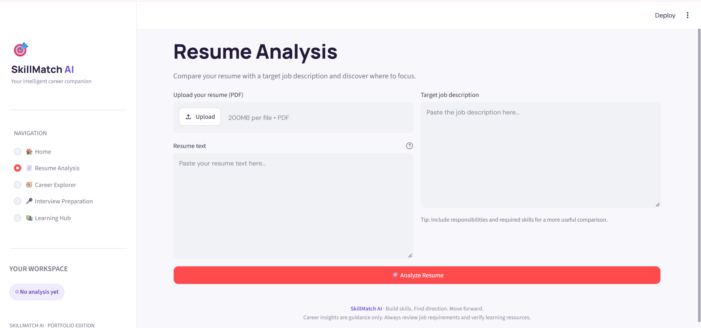
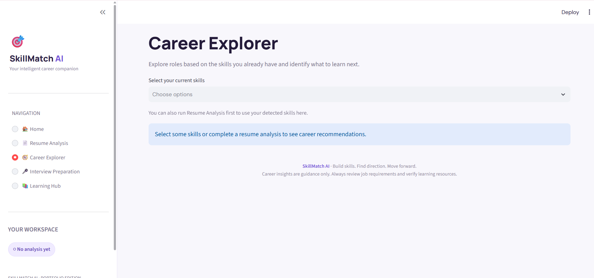
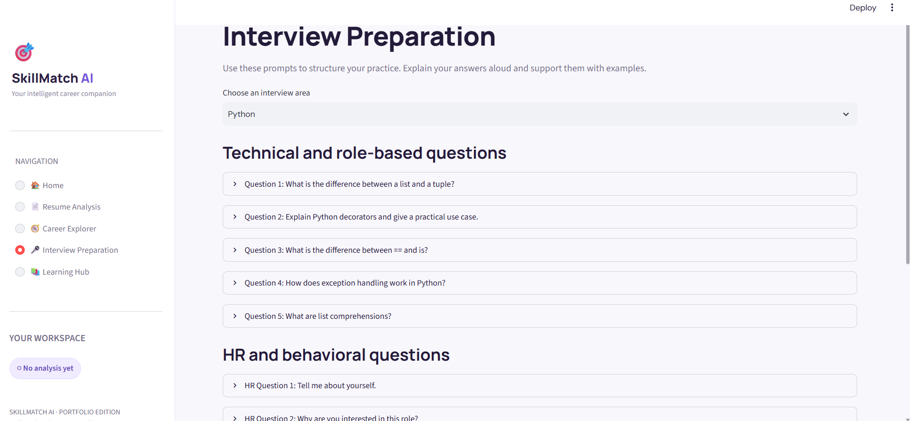
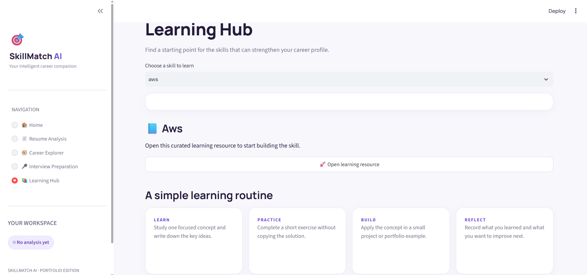

# 🎯 SkillMatch AI – AI-Powered Career Companion

A Python and Streamlit-based career companion that helps job seekers analyze resumes, estimate ATS compatibility, identify skill gaps, explore career opportunities, prepare for interviews, and discover learning resources.

---

## 📸 Application Screenshots

### 🏠 Home Page


### 📄 Resume Analysis


### 🧭 Career Explorer


### 🎤 Interview Preparation


### 📚 Learning Hub


---

## ✨ Features

- **Resume Analysis:** Upload a PDF resume or paste resume content.
- **ATS Score Estimation:** Get a keyword-based ATS compatibility estimate.
- **Skill Matching:** Compare resume skills with job description requirements.
- **Skill Gap Analysis:** Identify missing skills and areas for improvement.
- **Career Explorer:** Discover career opportunities based on existing skills.
- **Interview Preparation:** Practice technical and HR interview questions.
- **Learning Hub:** Explore curated learning resources.
- **Learning Roadmap:** Follow a structured four-week learning plan.
- **Downloadable Reports:** Export your resume analysis results.

## 🛠️ Tech Stack

| Technology | Purpose |
|---|---|
| Python | Core programming language |
| Streamlit | Web application framework |
| Plotly | Interactive visualizations |
| Pandas | Data handling |
| PyPDF | PDF resume extraction |

## 📁 Project Structure

```text
SkillMatch-AI/
│
├── app.py
├── requirements.txt
├── README.md
├── .gitignore
│
└── screenshots/
    ├── home.png
    ├── resume-analysis.png
    ├── career-explorer.png
    ├── interview-preparation.png
    └── learning-hub.png
```

## 🚀 Getting Started

### 1. Clone the repository

```bash
git clone https://github.com/shifaa126/SkillMatch-AI.git
```

```bash
cd SkillMatch-AI
```

### 2. Create a virtual environment

**Windows:**

```bash
python -m venv .venv
```

Activate it:

```bash
.venv\Scripts\activate
```

**macOS / Linux:**

```bash
python3 -m venv .venv
```

```bash
source .venv/bin/activate
```

### 3. Install dependencies

```bash
pip install -r requirements.txt
```

### 4. Run the application

```bash
streamlit run app.py
```

Open the local URL provided by Streamlit, usually:

```text
http://localhost:8501
```

## 📖 How to Use

1. Launch SkillMatch AI.
2. Navigate to Resume Analysis.
3. Upload your PDF resume or paste your resume text.
4. Paste the target job description.
5. Click Analyze Resume.
6. Review your ATS estimate, matched skills, and missing skills.
7. Explore career recommendations.
8. Practice interview questions.
9. Follow learning resources to improve your skills.

## ⚠️ Limitations

- ATS compatibility is estimated using keyword matching, not a real ATS platform.
- Skill detection uses predefined keywords and may not recognize every synonym or context.
- Scanned PDF resumes are not supported without OCR.
- The application currently does not use an external AI model or paid API.
- Career recommendations are intended as guidance.

## 🔮 Future Improvements

- AI-powered resume feedback.
- Context-aware skill extraction.
- DOCX resume support.
- OCR for scanned resumes.
- Personalized career recommendations.
- Resume analysis history.
- PDF report generation.
- Cloud deployment.

## 👩‍💻 Developer

**Shifaa126**

GitHub: [@shifaa126](https://github.com/shifaa126)

## 📄 License

No license has currently been selected for this repository.
