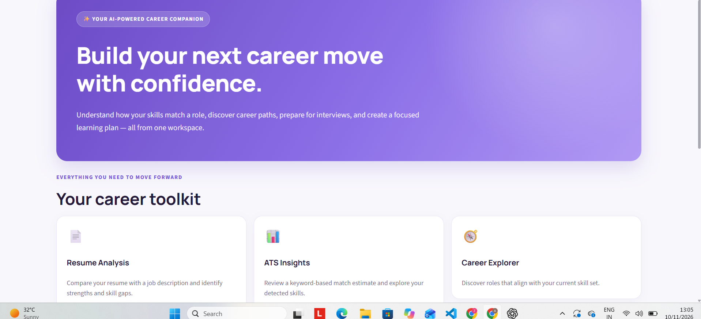

# SkillMatch AI 🎯

A Streamlit-based career companion that helps job seekers compare resume skills with a target job description, explore career paths, prepare for interviews, and find learning resources.

## Features

- **Resume Analysis:** Upload a text-based PDF resume or paste resume content.
- **Skill Matching:** Compare detected resume skills with skills mentioned in a job description.
- **ATS Estimate:** View a heuristic, keyword-based ATS-style estimate and skill coverage.
- **Skill Gap Insights:** Identify skills mentioned in the job description but not detected in the resume.
- **Career Explorer:** Explore entry-level role suggestions based on detected or selected skills.
- **Interview Preparation:** Practice technical and behavioral interview questions.
- **Learning Hub:** Browse curated learning resources and follow a simple learning routine.
- **Exportable Report:** Download a plain-text summary of the latest resume analysis.

## Tech Stack

- Python
- Streamlit
- Plotly
- pandas
- pypdf

## Project Structure

```text
skillmatch-ai/
├── app.py
├── requirements.txt
├── .gitignore
└── README.md
```

## Getting Started

### 1. Clone the repository

```bash
git clone https://github.com/YOUR-USERNAME/skillmatch-ai.git
cd skillmatch-ai
```

Replace `YOUR-USERNAME` with your GitHub username.

### 2. Create and activate a virtual environment (recommended)

**Windows PowerShell:**

```powershell
python -m venv .venv
.venv\Scripts\Activate.ps1
```

**macOS / Linux:**

```bash
python3 -m venv .venv
source .venv/bin/activate
```

### 3. Install dependencies

```bash
pip install -r requirements.txt
```

### 4. Run the app

```bash
streamlit run app.py
```

Streamlit will print a local URL, usually `http://localhost:8501`. Open it in your browser.

## How to Use

1. Open **Resume Analysis**.
2. Upload a text-based PDF resume or paste your resume text.
3. Paste the job description for the role you are targeting.
4. Select **Analyze Resume**.
5. Review the estimated scores, matched skills, and skill gaps.
6. Explore **Career Explorer**, **Interview Preparation**, and **Learning Hub**.

## Important Notes and Limitations

- The ATS-style score is a **simple keyword-based estimate**. It is not generated by a real applicant tracking system and should not be treated as a hiring prediction.
- Skill detection is based on a predefined keyword list. It may miss synonyms, context, and skills that are written differently.
- PDF extraction works best with text-based PDFs. Scanned/image-only PDFs may require OCR, which is not included.
- Career suggestions and learning links are guidance, not professional hiring or career advice.
- The current application does not call an external AI model or paid API.

## Future Improvements

- Add synonym-aware and context-aware skill extraction.
- Support DOCX resumes and OCR for scanned PDFs.
- Add user-defined target roles and editable skill libraries.
- Save analysis history and export a polished PDF report.
- Add unit tests and automated deployment.

## Screenshots

After running the app, capture screenshots of the Home, Resume Analysis, Career Explorer, Interview Preparation, and Learning Hub pages. Add them to a `screenshots/` folder and embed them here, for example:

```markdown

```

## License

Choose a license before making the repository public. For a personal portfolio project, the MIT License is a common permissive option; only add it if you are comfortable allowing reuse under its terms.
